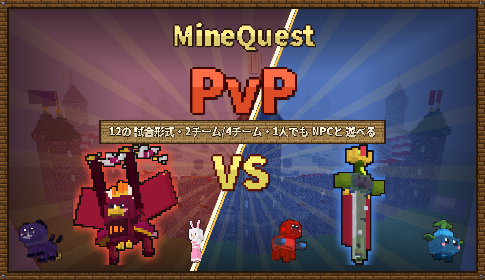
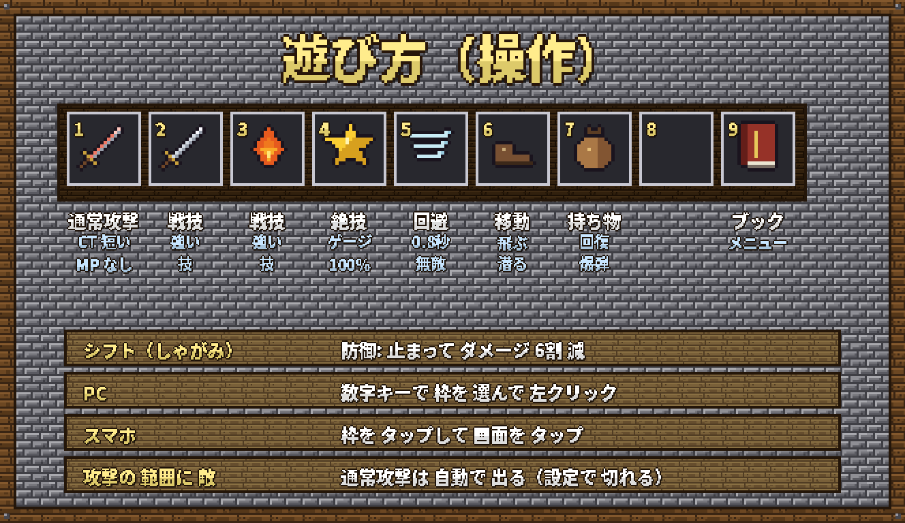
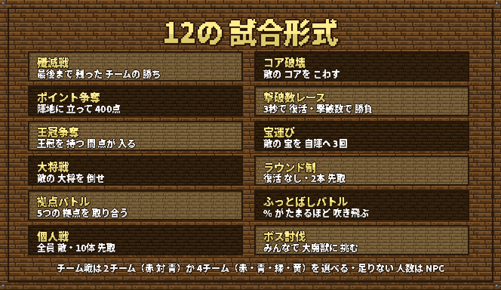
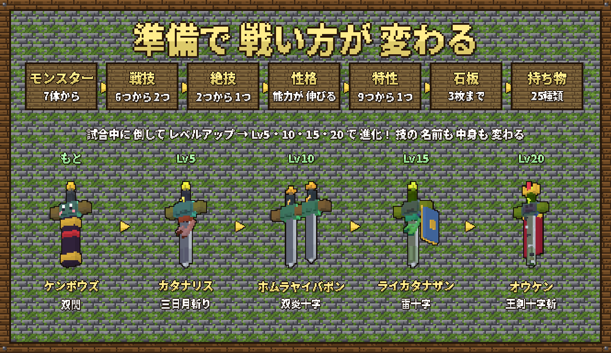
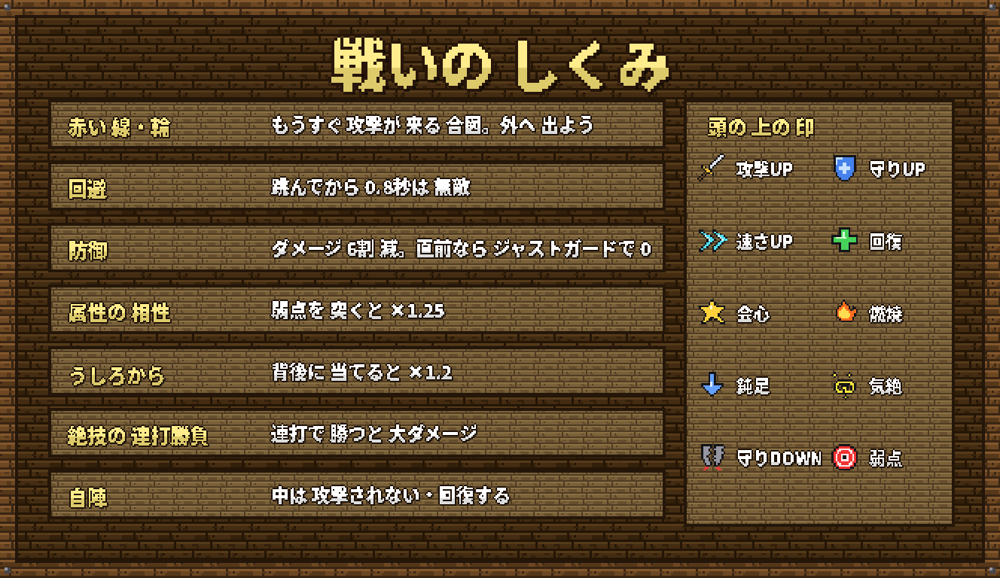
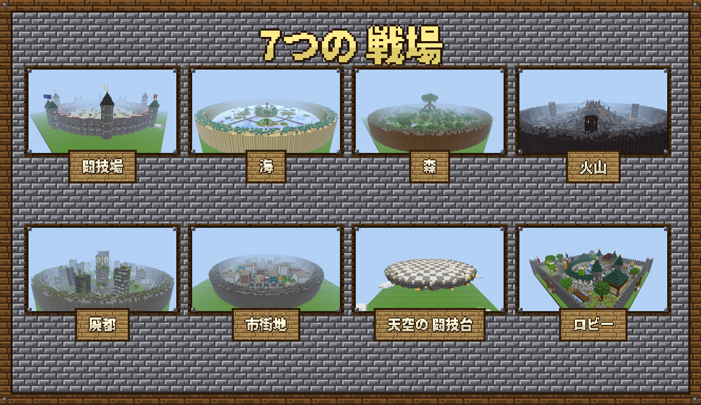

# マインクエスト（MINE QUEST）第128版

野生の モンスターを スカウトして 仲間にし、配合と 育成で 最強の チームを 作る マインクラフト統合版の アドオンです。
901体の モンスター、本編20章・裏15章の 物語、王と 神、クリア後の やりこみまで 遊べます。無料です。

## ダウンロード（押すと すぐ 保存されます）

| ファイル | 内容 |
|---|---|
| **[攻略サイト](https://claude.ai/artifact/SV4zHYstG1JasnapW6ddwX)** | モンスター 901体・技・スキル・特性・道具・配合表・探索・町・きずな・遊び場（[文字だけの 攻略ガイド](GUIDE.md)も あり） |
| **[本体](https://github.com/JOKER05www/mine-quest/raw/main/files/MineQuest_v3_0_0.mcaddon)** | 必須。モンスター・バトル・街・物語・アイテム すべて 入り（11.0MB・軽量版 8.5MB） |
| **[配布マップ](https://github.com/JOKER05www/mine-quest/raw/main/files/MineQuest_map.mcworld)** | 任意。11の 地方の 世界と 灰の 街。開くだけで 遊べる（約39MB・軽量版 約36MB・ワールド名「マインクエスト 第128版」） |
| [追加ストーリー「常世編」](https://github.com/JOKER05www/mine-quest/raw/main/files/MineQuest_Story_Tokoyo.mcpack) | 任意。クリア後の 物語の 続き。本体と 同じ ワールドの ビヘイビアーパックに 入れる |
| [マップの アップデートツール（PC）](https://github.com/JOKER05www/mine-quest/raw/main/files/MineQuest_update.zip) | 前の 版の 配布マップを 第128版に する（約26MB）（冒険の 続きは そのまま。町や 城の 並びは 前の まま） |

## 新作「MineQuest PvP」（対戦ワールド）

7体の モンスターから 1体を 選び、技・性格・特性・石板・持ち物を 組んで 戦う 対戦ワールドです。1人でも NPCと 遊べます。マルチプレイにも 対応しています。

| ファイル | 内容 |
|---|---|
| **[MineQuest PvP](https://github.com/JOKER05www/mine-quest/raw/main/files/MineQuest_PvP.mcworld)** | 開くだけで 遊べる ワールド（約2.6MB）。試合形式 12種・ステージ 7つ・チュートリアル つき |

MineQuest PvPの 遊び方（画像）

## 入れかた
1. 本体（`MineQuest_v3_0_0.mcaddon`）を ダブルクリック（タップ）。マイクラが 開いて 自動で 入ります
2. 新しい ワールドを 作り、ビヘイビアーパックで「マインクエスト」を 有効に する
   - 配布マップは `MineQuest_map.mcworld` を 開くだけで 遊べます
3. 追加ストーリーで 遊ぶ ときは `MineQuest_Story_Tokoyo.mcpack` も 同じ ワールドに 入れて 有効に する

## Switch・スマホで 落ちる 方へ（軽量版）
モンスターを ドット絵に して 軽く した 版です。**ワールドを 開く 人（ホスト）だけが 入れれば、参加者 全員が 軽量版に なります。**

| ファイル | 使う とき |
|---|---|
| **[軽量版の 本体](https://github.com/JOKER05www/mine-quest/raw/main/files/MineQuest_v3_0_0_lite.mcaddon)** | 新しい ワールド・Switch や スマホで ホストを する とき |
| **[軽量版の 配布マップ](https://github.com/JOKER05www/mine-quest/raw/main/files/MineQuest_map_lite.mcworld)** | 配布マップを 軽量版で はじめから |
| [軽量版 アップデートツール（PC）](https://github.com/JOKER05www/mine-quest/raw/main/files/MineQuest_update_lite.zip) | いま 遊んで いる ワールドを 軽量版に する（展開して `update.bat`） |
| [サーバー用 4パック](https://github.com/JOKER05www/mine-quest/raw/main/files/MineQuest_lite_server_packs.zip) | レンタルサーバー（中の README の とおりに） |

それでも 重い ときは、ガイドブック →「冒険」→「設定」で 軽量モードを オン、マイクラの 描画距離を 6〜8 に してください。

## こまった とき
- ガイドブック →「冒険」→「バグを 直す」を ためしてください
- PCで ワールドを 開く ときに 落ちる 場合: 更新ツールで「灰都の 街も 入れますか？」に y と 答えた ときは、ツールが デスクトップに 作った バックアップを 元の 場所に 戻し、n で もう一度 更新して ください（街は ゲームの 中で 少しずつ 建ちます）
